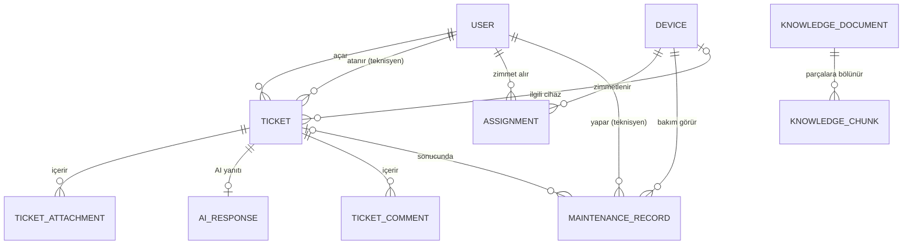

# IT Destek ve Envanter Otomasyonu (RAG Destekli)

Bu proje bir **Yazılım Tasarım Mimarisi** dersi projesidir. Değerlendirme, kodun çalışmasından çok **mimari kararların ve tasarım desenlerinin doğru uygulanıp gerekçelendirilmesi** üzerinden yapılacak.

Bir fakültenin BT departmanı için: cihaz envanteri ve zimmet takibi, bakım geçmişi, arıza kaydı (ticket) yönetimi ve kullanıcı sorunlarını önce RAG tabanlı bir yapay zeka ile otomatik yanıtlamaya çalışan bir sistem.

---

## Benimle nasıl çalışmalısın (ÖNEMLİ)

- Ben bu projeyi öğrenerek yapıyorum. Sunumda her kararı açıklayabilmem gerekiyor.
- **Adım adım ilerle.** Bir seferde tek bir küçük hedef (bir dosya grubu, bir özellik) üzerinde çalış.
- Her adımda **ne yaptığını ve neden yaptığını** kısaca Türkçe açıkla. Bir tasarım deseni kullandığında hangi desen olduğunu ve burada neden tercih edildiğini belirt.
- **Benim onayım olmadan bir sonraki adıma geçme.**
- Projede yazılı olmayan büyük bir mimari karar gerekiyorsa önce bana sor.
- Geliştirme ortamı **Windows**. Terminal komutlarını PowerShell'e uygun ver.
- Her anlamlı adımın sonunda commit mesajı öner ve bu dosyadaki plan kutucuğunu işaretle.

## Dil kuralları

- Backend: **Python 3.11+**
- Frontend: **TypeScript** (React)
- Kod (sınıf, fonksiyon, değişken, tablo, bileşen adları): **İngilizce**
- Kod yorumları ve docstring'ler: Türkçe olabilir
- Kullanıcıya görünen metinler (arayüz, API hata mesajları): **Türkçe**

---

## Teknoloji

| Alan | Seçim |
|---|---|
| API | FastAPI + Uvicorn |
| ORM | SQLAlchemy 2.x (`DeclarativeBase` stili) |
| Veri doğrulama / ayarlar | Pydantic, pydantic-settings |
| Veritabanı | **PostgreSQL 16 + pgvector**, **Docker Compose** ile çalışır |
| DB sürücüsü | psycopg 3 (`postgresql+psycopg://...`) |
| Migration | Alembic |
| Vektör arama | pgvector (ayrı bir vektör DB yok, Chroma kullanılmıyor) |
| LLM | Ollama (yerelde, Docker dışında kurulur); en son eklenecek |
| Frontend | **React + TypeScript**, Vite ile kurulur |
| Frontend veri katmanı | TanStack Query (okumalar `useQuery`, yazmalar `useMutation`) |
| Frontend yönlendirme | React Router |
| Frontend UI | Tailwind CSS + shadcn/ui |
| Test | pytest (backend), Vitest (frontend, opsiyonel) |
| CI | GitHub Actions (testler ve lint her push'ta çalışır) |

- Veritabanı: `docker compose up -d` ile başlar. İmaj: `pgvector/pgvector:pg16`.
- API: `uvicorn app.main:app --reload` → `http://127.0.0.1:8000/docs`
- Frontend: `frontend/` klasöründe `npm run dev` → `http://localhost:5173`
- Backend'de frontend adresi için CORS izni tanımlanır.
- Gerçek RAG hazır olana kadar AI tarafı sahte (fake) implementasyonla çalışır.
- Ollama modelleri: `ollama pull bge-m3` (embedding, 1024 boyut), `ollama pull qwen2.5:3b` (yanıt).
- Bilgi bankası (`data/knowledge/*.md`) indeksleme: `python -m app.infrastructure.ai.indexing` (Ollama açık olmalı; tekrar çalıştırılabilir).
- Güven aralığı kalibrasyonu ve uçtan uca deneme: `python -m app.infrastructure.ai.calibrate [--with-llm]`. Gerçek AI için `.env`'de `AI_PROVIDER=rag`. CPU'da bir yanıt ~45-75 sn sürer (arka planda üretilir).

---

## Mimari

### Genel yapı: Modüler monolit
Tek uygulama, içi net katmanlarla ayrılmış. Mikroservis kullanılmayacak (ders projesi için gereksiz karmaşıklık).

### Katmanlar: Sadeleştirilmiş Clean Architecture

```
api/             → HTTP katmanı (FastAPI router'ları, request/response şemaları)
application/
  commands/      → CQRS yazma tarafı: iş akışları (command + handler)
  queries/       → CQRS okuma tarafı: listeler, raporlar
  interfaces/    → soyut arayüzler (repository'ler, AiSupportFacade, event bus)
domain/          → saf iş mantığı: varlıklar, enum'lar, decorator'lar, state, iş kuralları
infrastructure/
  db/            → SQLAlchemy modelleri, session, repository implementasyonları
  ai/            → RAG alt sistemleri + Facade implementasyonu + FakeAiSupport
  events/        → event bus implementasyonu (uygulama içi, senkron)
  notifications/ → bildirim kanallarının göndericileri (Strategy; e-posta/SMS benzetim)
  storage/       → ekran görüntüsü dosya depolama
```

**Bağımlılık kuralı:** içteki katman dıştakini bilmez.
- `domain` hiçbir katmana bağımlı değildir (SQLAlchemy veya FastAPI import etmez).
- `application` yalnızca `domain`'i ve `application/interfaces` içindeki soyutlamaları bilir.
- Somut veritabanı, LLM ve dosya kodu `infrastructure`'da yaşar.
- Bağımlılıklar FastAPI'nin `Depends` mekanizmasıyla enjekte edilir.

### CQRS
- Yazma (`commands/`) ve okuma (`queries/`) ayrı modüllerde, ayrı handler sınıflarında.
- Her handler `CommandHandler` / `QueryHandler` soyut tabanından türer (`commands/base.py`, `queries/base.py`); ortak yetki ve "bulunamadı" kontrolleri bu tabanların korumalı metotlarıdır. Command/query verileri değiştirilemez dataclass'lardır (`*Command`, `*Query`; kullanıcının başlattıkları `ActorCommand` / `ActorQuery`). Bu düzeni `tests/test_oop_structure.py` denetler.
- PostgreSQL'de iki şema:
  - `write` şeması: normalize tablolar, iş kuralları burada uygulanır.
  - `read` şeması: raporlar için denormalize read model tabloları (örn. `ticket_summary`, `inventory_report`, `failure_stats`).
- Read model'ler, yazma işleminden sonra **uygulama içi event bus** (Observer) ile aynı istekte güncellenir. Mesaj kuyruğu (RabbitMQ vb.) kullanılmayacak.
- Dinleyiciler `EventHandler` soyut sınıfından türer: `EventLogger`, `AutoAnswerScheduler`, bildiriciler `TicketCreatedNotifier` / `TicketStatusNotifier` (`application/event_handlers.py`) ve projektörler (her projektör `source_events` ile hangi olayları dinlediğini kendisi bildirir). Abonelikler tek yerde: `core/event_subscriptions.py` (`EventSubscriptions`).
- Veritabanı bağlantısı global değildir: `Database` sınıfının tek nesnesi kompozisyon kökünde (`get_database`) kurulur; sınıflara oturum fabrikası enjekte edilir.
- Uygulanan read model'ler: `read.ticket_summary` (talep listeleri), `read.device_inventory` (envanter raporu, zimmetli cihazlarım).
- Arıza istatistikleri (UC-12) ayrı bir `failure_stats` tablosu yerine `read.ticket_summary` üzerinde toplama sorgularıyla hesaplanır (`infrastructure/db/statistics.py`, PostgreSQL `FILTER`); ikinci bir kopyayı tutarlı tutma maliyeti bu ölçekte gereksiz.
- Projektörler (`infrastructure/db/projections.py`) olay geldiğinde ilgili satırı **write tablolarından yeniden hesaplar** (idempotent, sıradan bağımsız). Olay üretmeden yapılan değişikliklerden sonra (seed, elle SQL) yeniden kurma: `python -m app.infrastructure.db.projections` (seed scripti bunu kendisi çağırır).
- Okuma tarafı karma: çok tabloyu birleştiren listeler read model'den; tek tablodan gelen veriler (bakım geçmişi, talep notları/ekleri) write tablolarından salt okunur sorguyla. Query handler'lar domain nesnesi/repository kullanmaz, DTO döner.
- **Event Sourcing kullanılmayacak.**
- Gerekçe: okuma (rapor/istatistik) ve yazma (iş kuralı/doğrulama) farklı veri şekillerine ihtiyaç duyuyor. "Yüksek performans" iddiası abartılmayacak.

### Frontend mimarisi
- Frontend ve backend tamamen ayrı iki uygulamadır; aralarındaki tek bağ REST API'dir.
- CQRS ön yüzde de yansıtılır: okumalar `src/api/queries/` altında `useQuery` hook'ları, yazmalar `src/api/commands/` altında `useMutation` hook'ları.
- Bileşenler API'yi doğrudan çağırmaz; yalnızca bu hook'ları kullanır (oxlint kuralı: `src/api` dışında `apiRequest`/`fetch` hata verir).
- Yazma hook'ları başarılı olunca ilgili sorgu anahtarlarını geçersiz kılar (`invalidateQueries`); güncel veri query tarafından yeniden okunur. Kullanıcıya özel sorgu anahtarları kullanıcı id'sini içerir.
- Arayüzdeki rol koruması (`RequireRole`) yalnızca kullanıcı deneyimi içindir; yetkinin asıl kontrolü backend'dedir.
- Sayfalar role göre ayrılır: kullanıcı, teknisyen, yönetici.

### Tasarım sistemi
- Renkler yalnızca `frontend/src/index.css` tema değişkenlerinden gelir (shadcn/ui); bileşenlerde sabit renk yazılmaz. Tek istisna rozet renkleri (aşağıda), onlar da tek dosyada: `components/ui/status-badge.tsx`.
- Düzen: koyu yan menü (rolün sayfaları) + beyaz üst çubuk (bildirimler, seçili kullanıcı) + lavanta zemin üzerinde beyaz kartlar.

| Değişken | Renk | Kullanım |
|---|---|---|
| `--background` | `#E6E1F7` | sayfa zemini (lavanta) |
| `--card`, `--popover` | `#FFFFFF` | kartlar ve paneller |
| `--border`, `--input` | `#D9D3F0` | kenarlık |
| `--foreground` / `--muted-foreground` | `#1E1B4B` / `#6B6890` | ana / ikincil metin |
| `--primary` / `--primary-hover` | `#4F46E5` / `#4338CA` | düğmeler, bağlantılar, seçili öğeler |
| `--sidebar` / `--sidebar-accent` | `#1E1B4B` / `#312E81` | yan menü zemini / seçili menü |
| `--sidebar-foreground` / `--sidebar-accent-foreground` | `#A5A3C9` / `#FFFFFF` | pasif / seçili menü yazısı |
| `--ai` / `--ai-border` / `--ai-foreground` | `#F5F3FF` / `#7C3AED` / `#5B21B6` | AI içeriği: zemin, 3px sol çizgi, yazı |

- **AI içeriği** yalnızca renkle ayırt edilmez: kutunun başında sparkles ikonu ve "AI önerisi" etiketi bulunur (`AiAnswerCard`).
- **Rozetler** tek bileşenden: `StatusBadge` (talep durumları ve işaretleri), aynı kalıpla `DeviceStatusBadge`. Her rozetin metni vardır; işaret rozetlerinde ayrıca ikon bulunur. Zemin / yazı:
  - Talep: Açık `#F1F5F9`/`#334155` · AI yanıtladı `#EDE9FE`/`#5B21B6` · Eskale `#FEF3C7`/`#92400E` · Atandı `#E0E7FF`/`#3730A3` · İşlemde `#E0F2FE`/`#075985` · Çözüldü `#DCFCE7`/`#166534` · Kapandı `#F1F5F9`/`#64748B`
  - İşaret: VIP `#FEF9C3`/`#854D0E` (taç) · Acil `#FEE2E2`/`#991B1B` (uyarı) · Kıdemli destek Atandı renginde (kalkan)
  - SLA geri sayımı (`SlaBadge`): normal Açık renginde · kalan süre %25'in altında Eskale renginde (sarı) · süre geçti Acil renginde (kırmızı) · süresinde çözüldü Çözüldü renginde
  - Cihaz: Depoda yeşil · Zimmetli indigo · Bakımda turuncu · Hurda gri

### Repository
- Command handler'lar veritabanına doğrudan değil, `application/interfaces` içindeki repository arayüzleri üzerinden erişir.
- Testlerde in-memory sahte repository kullanılabilir.
- Domain varlıkları `Entity` tabanından türer (`domain/entity.py`); alanları korumalıdır (`_`), `@property` ile okunur, yalnızca iş metotlarıyla değişir. Kimliği repository kaydedince `bind_id` ile bağlar.
- Domain ↔ ORM çevirisi her varlık için ayrı bir mapper sınıfındadır (`infrastructure/db/mappers.py`, Data Mapper).

---

## Nesne yönelimli programlama kuralları (HOCANIN ŞARTI — ZORUNLU)

Hoca projenin **nesne yönelimli programlamaya (OOP) ve tasarım desenlerine uygun** olmasını şart koştu. Python'da OOP'ye uymayan (fonksiyon ağırlıklı, sözlüklerle çalışan) kod yazmak kolay olduğu için aşağıdaki kurallar **tüm backend kodunda** geçerlidir:

### Dört temel ilke koda açıkça yansımalı
- **Kapsülleme (Encapsulation):** Domain sınıflarının durumu dışarıdan doğrudan değiştirilemez. Alanlar `_` ile korunur, okuma `@property` ile, değiştirme yalnızca anlamlı metotlarla yapılır (örn. `device.status = ...` yerine `device.assign_to(user)`).
- **Soyutlama (Abstraction):** Tüm arayüzler `abc.ABC` ve `@abstractmethod` ile tanımlanır (repository'ler, `AiSupportFacade`, `LlmProvider`, `EventHandler`, `TicketComponent`, `TicketState`).
- **Kalıtım (Inheritance):** Ortak davranış soyut temel sınıflarda toplanır (örn. `TicketDecorator(TicketComponent)`, `TicketState` alt sınıfları, `CommandHandler` / `QueryHandler` temel sınıfları).
- **Çok biçimlilik (Polymorphism):** `if/elif` ile tür veya durum kontrolü yerine çok biçimli metotlar kullanılır (decorator'lar `sla_hours()`'u, state sınıfları `escalate()` / `resolve()`'u kendi biçimlerinde uygular).

### Zengin domain modeli (Rich Domain Model)
- Domain varlıkları (`Device`, `Ticket`, `Assignment`, `User`, `MaintenanceRecord`) **davranış içeren sınıflardır**, sadece veri taşıyan yapı değildir.
- İş kuralları bu sınıfların metotlarında uygulanır. Örnekler: `Device.assign_to(user)`, `Device.return_from(user)`, `Device.start_maintenance()`, `Ticket.escalate()`, `Ticket.assign_to(technician)`, `Ticket.resolve()`.
- Kural ihlalinde domain'e özgü exception fırlatılır (`DeviceAlreadyAssignedError`, `InvalidTicketTransitionError` vb.), hepsi ortak bir `DomainError` sınıfından türer.
- **Domain sınıfları SQLAlchemy modellerinden ayrıdır.** SQLAlchemy modelleri `infrastructure/db` içindedir; repository'ler domain nesnesi ↔ ORM modeli dönüşümünü yapar (mapper).

### Sınıf tabanlı katmanlar
- Her command ve query bir **sınıftır**: veri için bir `@dataclass` (örn. `AssignDeviceCommand`), işleyici için bir handler sınıfı (örn. `AssignDeviceHandler.handle(command)`).
- FastAPI router fonksiyonları **ince** kalır: isteği alır, command/query nesnesini oluşturur, handler'a verir, sonucu döner. Router'da iş mantığı olmaz.
- Bağımlılıklar constructor üzerinden enjekte edilir (Dependency Injection); sınıflar bağımlılıklarını kendileri oluşturmaz.

### SOLID
- **S:** Her sınıfın tek sorumluluğu var (handler bir işi yapar, repository yalnızca veri erişimi yapar).
- **O:** Yeni özellik mevcut kodu değiştirmeden eklenir (yeni decorator, yeni state, yeni LLM sağlayıcısı = yeni sınıf).
- **L:** Alt sınıflar üst sınıfın yerine sorunsuz kullanılabilir (her decorator bir `TicketComponent`'tir).
- **I:** Arayüzler küçük ve amaca özel (tek dev repository yerine varlık başına repository).
- **D:** Üst katmanlar soyutlamalara bağımlıdır, somut sınıflara değil.

### Kod stili
- Tüm metot ve fonksiyonlarda **type hint** zorunlu.
- Her tasarım deseninin uygulandığı sınıfın docstring'inde desenin adı ve rolü yazılır (örn. `"""Decorator deseni — Concrete Decorator: VIP taleplerin SLA süresini kısaltır."""`).
- Global değişken ve modül seviyesinde iş mantığı yok.

### Kuralların otomatik denetimi
- `ruff check app tests migrations`: pyflakes, import sırası ve **zorunlu tip ipucu** (ANN; `app/` için, testler hariç). Ayarlar `pyproject.toml`.
- `tests/test_oop_structure.py`: handler'lar `CommandHandler` / `QueryHandler`'dan türer, command/query adları ve değiştirilemezliği, domain varlıklarının kapsüllenmesi (`Entity`, `_` alanlar, setter yok), çerçeve giriş noktaları dışında modül seviyesi fonksiyon yok.
- `tests/test_pattern_docstrings.py`: desen sınıflarının docstring'i desen adını ve rolünü yazar; tablo aynı zamanda "hangi desen hangi sınıfta" listesidir.
- `tests/test_architecture.py`: katman bağımlılık kuralı.

### Mevcut kodun uyumu
Bu bölüm eklenmeden önce yazılmış kod varsa, bir sonraki adıma geçmeden önce bu kurallara göre gözden geçir ve gerekiyorsa yeniden düzenle (refactor). Neyi neden değiştirdiğini açıkla.

---

## Tasarım desenleri

### Decorator
- Ticket'lara dinamik olarak **davranış** ekler (sadece veri değil): `sla_hours()`, `priority_score()`, `notify()` gibi metotları sarar ve değiştirir.
- Örnek: `UrgentTicket(VipTicket(BasicTicket(data)))` → SLA 72 → 24 → 4 saat; bildirimler zincirlenir.
- **Veritabanında decorator saklanmaz.** Ticket tablosunda `modifiers` listesi (örn. `["VIP", "URGENT"]`) tutulur. Okumada bir **Factory** bu listeye bakarak nesneyi sarar.
- VIP: kullanıcının `is_vip` alanından otomatik gelir. Acil: kullanıcı talep açarken işaretler, yönetici değiştirebilir.
- Yer: `domain/`

### Facade
- Arayüz: `application/interfaces` içinde `AiSupportFacade`, tek metot: `try_auto_resolve(ticket) -> AutoAnswer(answer, confidence, sources)`.
- Implementasyon: `infrastructure/ai` içinde. Arkasında embedding servisi, pgvector retriever, prompt builder, Ollama istemcisi gizlenir.
- Gerçek RAG hazır olana kadar `FakeAiSupport` kullanılır. Gerçeğe geçişte `application` ve `domain` katmanında değişiklik olmamalı (Facade'ın faydasının kanıtı).

### Destekleyici desenler (gerektiği kadar, abartmadan)
- **State:** Ticket yaşam döngüsü (`domain/`).
- **Observer:** Event bus; bildirim ve read model güncelleme.
- **Repository:** Veri erişim soyutlaması.
- **Data Mapper:** Domain varlığı ↔ SQLAlchemy modeli çevirisi (`infrastructure/db/mappers.py`); domain sınıfları veritabanını bilmez.
- **Unit of Work:** Bir command'ın tüm değişikliklerini tek transaction'da toplar (`with uow: ... uow.commit()`). Domain olayları `uow.add_event()` ile eklenir ve yalnızca başarılı commit'ten sonra event bus'a yayınlanır; rollback'te atılır.
- **Factory:** Decorator'lı ticket nesnesi üretimi.
- **Strategy:** LLM sağlayıcısını değiştirilebilir yapmak; bildirim kanalları (`NotificationSender`: uygulama içi, e-posta ve SMS benzetimi).
- **Bildirimler:** hangi bildirimin gerektiğine domain karar verir — talep açılınca Decorator zinciri (`notify()`), durum değişince yeni durumun State nesnesi (`entry_notifications()`). Alıcı bir kitledir (`NotificationAudience`), kişilere application'da çevrilir; nöbetçi = kıdemli (L2) teknisyenler. Bildirimler `write.notifications`'a kaydedilir, teslim commit'ten sonra yapılır; işlemi yapan kendi işlemi için bildirim almaz. Arayüzde zil menüsü yoklama (polling) ile okur.
- **Chain of Responsibility:** destek seviyeleri AI (L0) → teknisyen (L1) → kıdemli teknisyen (L2) (`domain/support_tier.py`). `Ticket.escalate()` iki desene sorar: State eskalasyonun bu durumda mümkün olup olmadığına, zincir talebi hangi seviyenin üstleneceğine karar verir. Yeniden açma seviyeyi değiştirmez.

---

## Klasör yapısı

```
it-support/
├── app/
│   ├── main.py
│   ├── core/              # config.py (ayarlar), dependencies.py (DI)
│   ├── api/
│   ├── application/
│   │   ├── commands/
│   │   ├── queries/
│   │   └── interfaces/
│   ├── domain/
│   └── infrastructure/
│       ├── db/
│       ├── ai/
│       ├── events/
│       └── storage/
├── migrations/            # Alembic
├── frontend/              # React + TypeScript (Vite)
│   └── src/
│       ├── api/           # client, queryKeys, queries/ (okuma), commands/ (yazma)
│       ├── auth/          # seçili kullanıcı (X-User-Id) context'i
│       ├── components/    # ui/ (shadcn/ui), layout/ (çerçeve, kullanıcı seçici, rol koruması)
│       ├── pages/         # user/, technician/, admin/ + ortak sayfalar
│       ├── types/         # API tipleri
│       └── navigation.ts  # rollere göre menü ve ana sayfalar
├── .github/workflows/     # CI
├── data/
│   ├── knowledge/         # RAG dokümanları
│   └── uploads/           # ekran görüntüleri
├── tests/
├── docs/                  # diyagramlar, rapor notları
├── docker-compose.yml
├── requirements.txt
├── .env
├── .gitignore
└── CLAUDE.md
```

---

## Aktörler

- **Kullanıcı** (öğrenci / personel)
- **Teknisyen**
- **BT Yöneticisi**
- **AI Asistan** (sistem aktörü)

## Kullanım senaryoları

| ID | Aktör | Senaryo | Tür | Kapsam |
|---|---|---|---|---|
| UC-01 | Kullanıcı | Arıza kaydı oluştur | Command | MVP |
| UC-02 | Kullanıcı | AI önerisini değerlendir (çözüldü / çözülmedi) | Command | MVP |
| UC-03 | Kullanıcı | Kendi taleplerini listele ve takip et | Query | MVP |
| UC-04 | Kullanıcı | Zimmetli cihazlarını görüntüle | Query | Ek |
| UC-05 | Teknisyen | Atanan talepleri listele | Query | MVP |
| UC-06 | Teknisyen | Talep durumunu güncelle, not ekle | Command | MVP |
| UC-07 | Teknisyen | Talebi üst seviyeye eskale et | Command | Ek |
| UC-08 | Yönetici | Cihaz ekle / güncelle | Command | MVP |
| UC-09 | Yönetici | Cihaz zimmetle / iade al | Command | MVP |
| UC-10 | Yönetici | Talebi teknisyene ata | Command | MVP |
| UC-11 | Yönetici | Envanter raporu | Query | MVP |
| UC-12 | Yönetici | Arıza istatistikleri | Query | Ek |
| UC-13 | Yönetici | Bilgi bankasına doküman ekle | Command | Ek |
| UC-14 | AI Asistan | Yeni talebe otomatik yanıt üret | Command | MVP |
| UC-15 | Kullanıcı | Talebe ekran görüntüsü ekle | Command | MVP |
| UC-16 | Teknisyen | Cihaza bakım/onarım kaydı gir | Command | MVP |
| UC-17 | Teknisyen, Yönetici | Cihaz bakım geçmişini görüntüle | Query | MVP |

**Kapsam dışı:** LDAP / kurum e-posta entegrasyonu. Kullanıcılar seed data ile gelir. Giriş/yetkilendirme "Ek" kapsamında; başta basit bir `X-User-Id` header'ı ile kullanıcı belirlenir (frontend'de üst menüde kullanıcı seçme kutusu).

---

## Domain modeli

- **User:** id, full_name, email, role (USER / TECHNICIAN / ADMIN), department, is_vip, support_level (yalnızca teknisyen: TIER_1 / TIER_2)
- **Device:** id, asset_tag, type, brand, model, serial_number, status (IN_STOCK / ASSIGNED / IN_REPAIR / RETIRED), location, purchase_date
- **Assignment:** id, device_id, user_id, assigned_by, assigned_at, returned_at (boşsa aktif)
- **MaintenanceRecord:** id, device_id, technician_id, ticket_id (opsiyonel), type (REPAIR / PERIODIC / PART_REPLACEMENT), description, previous_device_status, performed_at (başlangıç), completed_at (boşsa bakım sürüyor)
- **Ticket:** id, title, description, category (HARDWARE / SOFTWARE / NETWORK / ACCOUNT), status, requester_id, assignee_id, device_id (opsiyonel), modifiers (liste), support_level (AI / TIER_1 / TIER_2), created_at, resolved_at
- **TicketAttachment:** id, ticket_id, file_path, mime_type, uploaded_at
- **AIResponse:** id, ticket_id, answer, confidence, sources, user_feedback (HELPFUL / NOT_HELPFUL / boş)
- **TicketComment:** id, ticket_id, author_id, content, created_at
- **KnowledgeDocument:** id, title, file_path, indexed_at
- **KnowledgeChunk:** id, document_id, content, embedding (pgvector `vector` tipi)



### Ticket durumları
`OPEN → AI_ANSWERED → (RESOLVED | ESCALATED) → ASSIGNED → IN_PROGRESS → RESOLVED → CLOSED`

Durum nesneleri yalnızca karar verir (izinliyse hedef durumu döndürür); geçişi `Ticket` kendisi uygular, böylece talebin alanlarına dışarıdan dokunulmaz.

Ek geçişler (State deseni, `domain/ticket_state.py`):
- `OPEN → ESCALATED`: AI güveni eşiğin altında (iş kuralı 4).
- `ASSIGNED / IN_PROGRESS → ASSIGNED`: başka teknisyene devir.
- `ASSIGNED / IN_PROGRESS → ESCALATED`: teknisyen üst seviyeye eskale eder (UC-07); atama boşalır.
- `RESOLVED → CLOSED`: talep sahibi veya yönetici çözümü onaylar.
- `RESOLVED → ESCALATED`: talep sahibi yeniden açar (sorun sürüyor).
- `CLOSED`: son durum; ek ve aciliyet değişikliği kabul etmez.

### İş kuralları
1. Bir cihazın aynı anda yalnızca bir aktif zimmeti olabilir.
2. Bakım kaydı açılınca cihaz `IN_REPAIR` olur, kapanınca önceki durumuna döner.
3. Ticket yalnızca `TECHNICIAN` rolündeki kullanıcıya atanabilir.
4. AI güven skoru `AI_CONFIDENCE_THRESHOLD` (varsayılan 0.6) altındaysa ticket doğrudan `ESCALATED` olur.
5. Ekran görüntüsü yalnızca png/jpg ve belirli boyut sınırı (`MAX_UPLOAD_SIZE_MB`, varsayılan 5) altında kabul edilir. Tür, dosya adına değil içeriğin ilk baytlarına (magic bytes) bakılarak belirlenir. Ek yalnızca talep sahibi, atanan teknisyen ve yönetici tarafından yüklenebilir; kapanmış talebe ek eklenemez.
6. Cihaz durumu doğrudan güncellenemez; yalnızca iş akışlarıyla değişir (zimmet/iade, bakım aç/kapat, hurdaya ayır).
7. Yalnızca depodaki (`IN_STOCK`) cihaz zimmetlenebilir veya hurdaya ayrılabilir.
8. Bir cihazın aynı anda yalnızca bir açık bakım kaydı olabilir; hurdaya ayrılmış cihaza bakım açılamaz.
9. Bakımdaki cihaz iade alınamaz (bakım bitince `ASSIGNED`'a dönüp zimmetsiz kalmasın diye).
10. Yetki (basit rol kontrolü, `X-User-Id`): cihaz/zimmet işlemleri `ADMIN`, bakım işlemleri `TECHNICIAN`, talep açma her rol, aciliyeti değiştirme ve teknisyen atama `ADMIN`, çalışmaya başlama/çözme yalnızca atanan teknisyen, kapatma talep sahibi veya `ADMIN`, yeniden açma yalnızca talep sahibi; ek ve not ekleme talebin tarafları (talep sahibi, atanan teknisyen, `ADMIN`).
11. Ticket modifier'ları istemciden alınmaz: VIP talep sahibinin `is_vip` alanından, URGENT `is_urgent` isteğinden gelir. Decorator'larda SLA üst sınırdır (VIP en geç 24, Acil en geç 4 saat), öncelik puanı katmanlarca eklenir.
12. Talep yalnızca seviyesine yetecek teknisyene atanabilir: L2 (kıdemli) talep yalnızca `TIER_2` teknisyene; en üst seviyedeki talep daha fazla eskale edilemez.

### Ana akış
1. Kullanıcı arıza kaydı açar (UC-01), isteğe bağlı ekran görüntüsü ekler (UC-15).
2. Factory, modifier'lara göre ticket'ı decorator'larla sarar.
3. AiSupportFacade yanıt üretir (UC-14). `TicketCreated` olayını dinleyen bir Observer `AutoAnswerTicketHandler`'ı çağırır; talep açma kodu AI'dan habersizdir. AI hata verirse talep eskale edilir. Düşük güvenli yanıt da istatistik için saklanır ama kullanıcıya gösterilmez.
   - AI yanıtı **arka planda** üretilir (`infrastructure/events/task_runner.py`, tek işçili kuyruk): talep açma isteği LLM'i beklemez; talep yanıt gelene kadar `OPEN` kalır, frontend bu sürede yoklama (polling) yapar. Testlerde aynı işler `InlineTaskRunner` ile hemen çalışır.
   - AI çağrısı açık bir transaction içinde yapılmaz (okuma → AI → kısa yazma transaction'ı).
   - Kuyruk bellektedir; açılışta `OPEN` talepler yeniden kuyruğa alınır.
   - RAG güven skoru: en iyi parçanın kosinüs benzerliğinin `[RAG_SIMILARITY_FLOOR, RAG_SIMILARITY_CEILING]` aralığına izdüşümü; LLM `BILGI_YOK` derse skor düşürülür.
4. Kullanıcı "çözüldü" derse kapanır (`AI_ANSWERED → RESOLVED → CLOSED`, ayrıca onay istenmez); "çözülmedi" ya da düşük güven skoru → eskalasyon ve teknisyen ataması.
5. Her yazma işleminden sonra event bus olay yayınlar, read model'ler güncellenir.

---

## Uygulama planı

- [x] **1. Ortam ve iskelet:** Docker Compose ile PostgreSQL + pgvector, sanal ortam, klasör yapısı, config, DB bağlantısı, `/health` endpoint (DB bağlantısını da kontrol etsin), `.gitignore`, git init
- [x] **2. Domain ve veritabanı:** enum'lar, domain varlıkları, SQLAlchemy modelleri (`write` şeması), Alembic ilk migration, seed data scripti
- [x] **3. Altyapı iskeleti:** repository arayüzleri ve implementasyonları, event bus, bağımlılık enjeksiyonu
- [x] **4. Envanter (Command):** cihaz ekleme, zimmetleme/iade, bakım kaydı + iş kuralları + testler
- [x] **5. Ticket (Command):** oluşturma, ekran görüntüsü yükleme, Decorator + Factory + testler
- [x] **6. State:** ticket durum geçişleri + testler
- [x] **7. AI Facade:** `AiSupportFacade` arayüzü + `FakeAiSupport`, ticket akışına bağlama, eskalasyon
- [x] **8. Query tarafı:** `read` şeması, read model'ler + event bus ile güncelleme, kullanıcı/teknisyen listeleri, bakım geçmişi, envanter raporu
- [x] **9. Frontend kurulumu:** Vite + React + TypeScript, Tailwind + shadcn/ui, React Router, TanStack Query, API client, CORS, rol seçici ve sayfa iskeleti
- [x] **10. Frontend ekranları:** kullanıcı (talep aç, ekran görüntüsü, AI yanıtını değerlendir, taleplerim), teknisyen (atanan talepler, durum güncelle, bakım kaydı), yönetici (cihazlar, zimmet, atama, envanter raporu)
- [x] **11. Gerçek RAG:** Ollama kurulumu, embedding + pgvector, bilgi bankası dokümanları, Facade arkasına bağlama
- [x] **OOP uyumu (hocanın şartı, 12'den önce):** mevcut kodun "Nesne yönelimli programlama kuralları"na göre düzenlenmesi
  - [x] R1. Domain hata hiyerarşisi: `DomainError` tabanı ve kurala özgü hata sınıfları
  - [x] R2. `CommandHandler` / `QueryHandler` temel sınıfları; command/query nesneleri (`*Command`, `*Query`)
  - [x] R3. Domain kapsülleme (`_` alanlar, `@property`, anlamlı metotlar), mapper sınıfları, adların dokümana uydurulması (`TicketComponent`, `LlmProvider`, `assign_to` …)
  - [x] R4. `EventHandler` sınıfları, global veritabanı nesneleri yerine `Database` sınıfı, modül seviyesi yardımcı fonksiyonların sınıflara taşınması
  - [x] R5. Eksiksiz type hint, desen docstring'leri, OOP kurallarını denetleyen mimari testler
- [ ] **12. Ekler:** her ek, bir tasarım desenini arayüzde görünür kılar. Sıra: E1–E4, ardından (MVP ve gerçek RAG bittikten sonra) E5.
  - [x] Arıza istatistikleri ve grafikler (yönetici paneli; UC-12)
  - [x] Eskalasyon zinciri (Chain of Responsibility; UC-07)
  - [x] Bildirimler (Observer + Strategy)
  - [x] **E1. SLA geri sayımı — Decorator:** her talep kartında çözülme süresine kalan zaman geri sayar. Süre decorator'lardan gelen `sla_hours()` değerinden hesaplanır (VIP/Acil daha kısa). Kalan süre %25'in altına inince sarı, süre geçince kırmızı. Detay sayfasında hangi decorator'ların uygulandığı ve SLA'yı nasıl etkilediği (72 → 24 → 4 saat) görünür.
  - [x] **E2. Teknisyen Kanban panosu — State:** "Atandı / İşlemde / Çözüldü" sütunları, sürükle-bırak ile durum değişikliği (dnd-kit). Geçişi backend'deki State sınıfları doğrular; geçersiz geçişte kart eski yerine animasyonla döner ve backend'in hata mesajı toast olarak gösterilir. Geçiş kuralı frontend'de tekrar yazılmaz, tek yerde (backend State) kalır.
  - [ ] **E3. Talep zaman çizelgesi — Observer (+ CQRS okuma tarafı):** talep detayında dikey timeline: oluşturulma, AI yanıtı, kullanıcı geri bildirimi, eskalasyon, atama, durum değişiklikleri, notlar; her adımda saat ve kişi. Veri, event bus'a yayınlanan olaylardan beslenen `read.ticket_timeline` read model'inden okunur.
  - [ ] **E4. AI cevabında kaynak gösterimi — Facade (RAG):** `AutoAnswer.sources` alanındaki dokümanlar cevabın altında tıklanabilir etiketler olarak görünür; tıklanınca ilgili doküman parçası açılır.
  - [ ] **E5. Cihaz QR kodu — CQRS okuma tarafı (opsiyonel, en son):** yeni bir desen eklemez; cihaz detayı mevcut `read.device_inventory` read model'inden okunur. Her cihaz için QR etiketi; okutulunca cihaz detay sayfası açılır (zimmet, bakım geçmişi, "Arıza bildir" düğmesi). Yazdırılabilir etiket sayfası.
- [ ] **13. Kalite ve CV:** GitHub Actions CI, test kapsamı, ekran görüntülü ve mimari diyagramlı README, GitHub'a yükleme
- [ ] **14. Dokümantasyon:** UML sınıf/sekans diyagramları (`docs/`; sınıf diyagramları `pyreverse` ile koddan otomatik üretilebilir), her desen ve OOP ilkesi için "nerede, neden" tablosu, ders raporu

Tamamlanan adımları bu listede işaretle.
