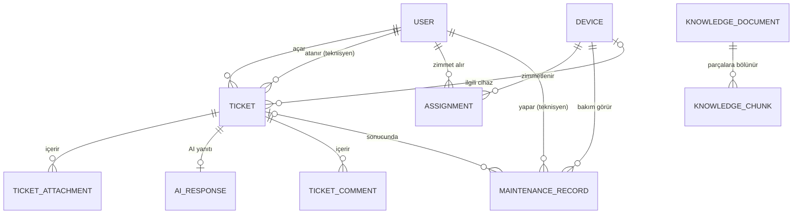

# IT Destek ve Envanter Otomasyonu (RAG Destekli)

Bu proje bir **Yazılım Tasarım Mimarisi** dersi projesidir. Değerlendirme, kodun çalışmasından çok **mimari kararların ve tasarım desenlerinin doğru uygulanıp gerekçelendirilmesi** üzerinden yapılacak.

Bir fakültenin BT departmanı için: cihaz envanteri ve zimmet takibi, bakım geçmişi, arıza kaydı (ticket) yönetimi ve kullanıcı sorunlarını önce RAG tabanlı bir yapay zeka ile otomatik yanıtlamaya çalışan bir sistem.

---

## Benimle nasıl çalışmalısın (ÖNEMLİ)

- Ben bu projeyi öğrenerek yapıyorum. Sunumda her kararı açıklayabilmem gerekiyor.
- **Adım adım ilerle.** Bir seferde tek bir küçük hedef (bir dosya grubu, bir özellik) üzerinde çalış.
- Her adımda **ne yaptığını ve neden yaptığını** kısaca Türkçe açıkla. Bir tasarım deseni kullandığında hangi desen olduğunu ve burada neden tercih edildiğini belirt.
- **Benim onayım olmadan bir sonraki adıma geçme.**
- Projede yazılı olmayan büyük bir mimari karar gerekiyorsa önce bana sor.
- Geliştirme ortamı **Windows**. Terminal komutlarını PowerShell'e uygun ver.
- Her anlamlı adımın sonunda commit mesajı öner ve bu dosyadaki plan kutucuğunu işaretle.

## Dil kuralları

- Backend: **Python 3.11+**
- Frontend: **TypeScript** (React)
- Kod (sınıf, fonksiyon, değişken, tablo, bileşen adları): **İngilizce**
- Kod yorumları ve docstring'ler: Türkçe olabilir
- Kullanıcıya görünen metinler (arayüz, API hata mesajları): **Türkçe**

---

## Teknoloji

| Alan | Seçim |
|---|---|
| API | FastAPI + Uvicorn |
| ORM | SQLAlchemy 2.x (`DeclarativeBase` stili) |
| Veri doğrulama / ayarlar | Pydantic, pydantic-settings |
| Veritabanı | **PostgreSQL 16 + pgvector**, **Docker Compose** ile çalışır |
| DB sürücüsü | psycopg 3 (`postgresql+psycopg://...`) |
| Migration | Alembic |
| Vektör arama | pgvector (ayrı bir vektör DB yok, Chroma kullanılmıyor) |
| LLM | Ollama (yerelde, Docker dışında kurulur); en son eklenecek |
| Frontend | **React + TypeScript**, Vite ile kurulur |
| Frontend veri katmanı | TanStack Query (okumalar `useQuery`, yazmalar `useMutation`) |
| Frontend yönlendirme | React Router |
| Frontend UI | Tailwind CSS + shadcn/ui |
| Test | pytest (backend), Vitest (frontend, opsiyonel) |
| CI | GitHub Actions (testler ve lint her push'ta çalışır) |

- Veritabanı: `docker compose up -d` ile başlar. İmaj: `pgvector/pgvector:pg16`.
- API: `uvicorn app.main:app --reload` → `http://127.0.0.1:8000/docs`
- Frontend: `frontend/` klasöründe `npm run dev` → `http://localhost:5173`
- Backend'de frontend adresi için CORS izni tanımlanır.
- Gerçek RAG hazır olana kadar AI tarafı sahte (fake) implementasyonla çalışır.

---

## Mimari

### Genel yapı: Modüler monolit
Tek uygulama, içi net katmanlarla ayrılmış. Mikroservis kullanılmayacak (ders projesi için gereksiz karmaşıklık).

### Katmanlar: Sadeleştirilmiş Clean Architecture

```
api/             → HTTP katmanı (FastAPI router'ları, request/response şemaları)
application/
  commands/      → CQRS yazma tarafı: iş akışları (command + handler)
  queries/       → CQRS okuma tarafı: listeler, raporlar
  interfaces/    → soyut arayüzler (repository'ler, AiSupportFacade, event bus)
domain/          → saf iş mantığı: varlıklar, enum'lar, decorator'lar, state, iş kuralları
infrastructure/
  db/            → SQLAlchemy modelleri, session, repository implementasyonları
  ai/            → RAG alt sistemleri + Facade implementasyonu + FakeAiSupport
  storage/       → ekran görüntüsü dosya depolama
```

**Bağımlılık kuralı:** içteki katman dıştakini bilmez.
- `domain` hiçbir katmana bağımlı değildir (SQLAlchemy veya FastAPI import etmez).
- `application` yalnızca `domain`'i ve `application/interfaces` içindeki soyutlamaları bilir.
- Somut veritabanı, LLM ve dosya kodu `infrastructure`'da yaşar.
- Bağımlılıklar FastAPI'nin `Depends` mekanizmasıyla enjekte edilir.

### CQRS
- Yazma (`commands/`) ve okuma (`queries/`) ayrı modüllerde, ayrı handler sınıflarında.
- PostgreSQL'de iki şema:
  - `write` şeması: normalize tablolar, iş kuralları burada uygulanır.
  - `read` şeması: raporlar için denormalize read model tabloları (örn. `ticket_summary`, `inventory_report`, `failure_stats`).
- Read model'ler, yazma işleminden sonra **uygulama içi event bus** (Observer) ile aynı istekte güncellenir. Mesaj kuyruğu (RabbitMQ vb.) kullanılmayacak.
- **Event Sourcing kullanılmayacak.**
- Gerekçe: okuma (rapor/istatistik) ve yazma (iş kuralı/doğrulama) farklı veri şekillerine ihtiyaç duyuyor. "Yüksek performans" iddiası abartılmayacak.

### Frontend mimarisi
- Frontend ve backend tamamen ayrı iki uygulamadır; aralarındaki tek bağ REST API'dir.
- CQRS ön yüzde de yansıtılır: okumalar `src/api/queries/` altında `useQuery` hook'ları, yazmalar `src/api/commands/` altında `useMutation` hook'ları.
- Bileşenler API'yi doğrudan çağırmaz; yalnızca bu hook'ları kullanır.
- Sayfalar role göre ayrılır: kullanıcı, teknisyen, yönetici.

### Repository
- Command handler'lar veritabanına doğrudan değil, `application/interfaces` içindeki repository arayüzleri üzerinden erişir.
- Testlerde in-memory sahte repository kullanılabilir.

---

## Tasarım desenleri

### Decorator
- Ticket'lara dinamik olarak **davranış** ekler (sadece veri değil): `sla_hours()`, `priority_score()`, `notify()` gibi metotları sarar ve değiştirir.
- Örnek: `UrgentTicket(VipTicket(BasicTicket(data)))` → SLA 72 → 24 → 4 saat; bildirimler zincirlenir.
- **Veritabanında decorator saklanmaz.** Ticket tablosunda `modifiers` listesi (örn. `["VIP", "URGENT"]`) tutulur. Okumada bir **Factory** bu listeye bakarak nesneyi sarar.
- VIP: kullanıcının `is_vip` alanından otomatik gelir. Acil: kullanıcı talep açarken işaretler, yönetici değiştirebilir.
- Yer: `domain/`

### Facade
- Arayüz: `application/interfaces` içinde `AiSupportFacade`, tek metot: `try_auto_resolve(ticket) -> AutoAnswer(answer, confidence, sources)`.
- Implementasyon: `infrastructure/ai` içinde. Arkasında embedding servisi, pgvector retriever, prompt builder, Ollama istemcisi gizlenir.
- Gerçek RAG hazır olana kadar `FakeAiSupport` kullanılır. Gerçeğe geçişte `application` ve `domain` katmanında değişiklik olmamalı (Facade'ın faydasının kanıtı).

### Destekleyici desenler (gerektiği kadar, abartmadan)
- **State:** Ticket yaşam döngüsü (`domain/`).
- **Observer:** Event bus; bildirim ve read model güncelleme.
- **Repository:** Veri erişim soyutlaması.
- **Factory:** Decorator'lı ticket nesnesi üretimi.
- **Strategy:** LLM sağlayıcısını değiştirilebilir yapmak.
- **Chain of Responsibility:** AI → teknisyen → üst seviye eskalasyon (opsiyonel).

---

## Klasör yapısı

```
it-support/
├── app/
│   ├── main.py
│   ├── core/              # config.py (ayarlar), dependencies.py (DI)
│   ├── api/
│   ├── application/
│   │   ├── commands/
│   │   ├── queries/
│   │   └── interfaces/
│   ├── domain/
│   └── infrastructure/
│       ├── db/
│       ├── ai/
│       └── storage/
├── migrations/            # Alembic
├── frontend/              # React + TypeScript (Vite)
│   └── src/
│       ├── api/           # client, queries/ (okuma), commands/ (yazma)
│       ├── components/    # ortak bileşenler (shadcn/ui)
│       ├── pages/         # user/, technician/, admin/
│       └── types/         # API tipleri
├── .github/workflows/     # CI
├── data/
│   ├── knowledge/         # RAG dokümanları
│   └── uploads/           # ekran görüntüleri
├── tests/
├── docs/                  # diyagramlar, rapor notları
├── docker-compose.yml
├── requirements.txt
├── .env
├── .gitignore
└── CLAUDE.md
```

---

## Aktörler

- **Kullanıcı** (öğrenci / personel)
- **Teknisyen**
- **BT Yöneticisi**
- **AI Asistan** (sistem aktörü)

## Kullanım senaryoları

| ID | Aktör | Senaryo | Tür | Kapsam |
|---|---|---|---|---|
| UC-01 | Kullanıcı | Arıza kaydı oluştur | Command | MVP |
| UC-02 | Kullanıcı | AI önerisini değerlendir (çözüldü / çözülmedi) | Command | MVP |
| UC-03 | Kullanıcı | Kendi taleplerini listele ve takip et | Query | MVP |
| UC-04 | Kullanıcı | Zimmetli cihazlarını görüntüle | Query | Ek |
| UC-05 | Teknisyen | Atanan talepleri listele | Query | MVP |
| UC-06 | Teknisyen | Talep durumunu güncelle, not ekle | Command | MVP |
| UC-07 | Teknisyen | Talebi üst seviyeye eskale et | Command | Ek |
| UC-08 | Yönetici | Cihaz ekle / güncelle | Command | MVP |
| UC-09 | Yönetici | Cihaz zimmetle / iade al | Command | MVP |
| UC-10 | Yönetici | Talebi teknisyene ata | Command | MVP |
| UC-11 | Yönetici | Envanter raporu | Query | MVP |
| UC-12 | Yönetici | Arıza istatistikleri | Query | Ek |
| UC-13 | Yönetici | Bilgi bankasına doküman ekle | Command | Ek |
| UC-14 | AI Asistan | Yeni talebe otomatik yanıt üret | Command | MVP |
| UC-15 | Kullanıcı | Talebe ekran görüntüsü ekle | Command | MVP |
| UC-16 | Teknisyen | Cihaza bakım/onarım kaydı gir | Command | MVP |
| UC-17 | Teknisyen, Yönetici | Cihaz bakım geçmişini görüntüle | Query | MVP |

**Kapsam dışı:** LDAP / kurum e-posta entegrasyonu. Kullanıcılar seed data ile gelir. Giriş/yetkilendirme "Ek" kapsamında; başta basit bir `X-User-Id` header'ı ile kullanıcı belirlenir (frontend'de üst menüde kullanıcı seçme kutusu).

---

## Domain modeli

- **User:** id, full_name, email, role (USER / TECHNICIAN / ADMIN), department, is_vip
- **Device:** id, asset_tag, type, brand, model, serial_number, status (IN_STOCK / ASSIGNED / IN_REPAIR / RETIRED), location, purchase_date
- **Assignment:** id, device_id, user_id, assigned_by, assigned_at, returned_at (boşsa aktif)
- **MaintenanceRecord:** id, device_id, technician_id, ticket_id (opsiyonel), type (REPAIR / PERIODIC / PART_REPLACEMENT), description, performed_at
- **Ticket:** id, title, description, category (HARDWARE / SOFTWARE / NETWORK / ACCOUNT), status, requester_id, assignee_id, device_id (opsiyonel), modifiers (liste), created_at, resolved_at
- **TicketAttachment:** id, ticket_id, file_path, mime_type, uploaded_at
- **AIResponse:** id, ticket_id, answer, confidence, sources, user_feedback (HELPFUL / NOT_HELPFUL / boş)
- **TicketComment:** id, ticket_id, author_id, content, created_at
- **KnowledgeDocument:** id, title, file_path, indexed_at
- **KnowledgeChunk:** id, document_id, content, embedding (pgvector `vector` tipi)



### Ticket durumları
`OPEN → AI_ANSWERED → (RESOLVED | ESCALATED) → ASSIGNED → IN_PROGRESS → RESOLVED → CLOSED`

### İş kuralları
1. Bir cihazın aynı anda yalnızca bir aktif zimmeti olabilir.
2. Bakım kaydı açılınca cihaz `IN_REPAIR` olur, kapanınca önceki durumuna döner.
3. Ticket yalnızca `TECHNICIAN` rolündeki kullanıcıya atanabilir.
4. AI güven skoru `AI_CONFIDENCE_THRESHOLD` (varsayılan 0.6) altındaysa ticket doğrudan `ESCALATED` olur.
5. Ekran görüntüsü yalnızca png/jpg ve belirli boyut sınırı altında kabul edilir.

### Ana akış
1. Kullanıcı arıza kaydı açar (UC-01), isteğe bağlı ekran görüntüsü ekler (UC-15).
2. Factory, modifier'lara göre ticket'ı decorator'larla sarar.
3. AiSupportFacade yanıt üretir (UC-14).
4. Kullanıcı "çözüldü" derse kapanır; "çözülmedi" ya da düşük güven skoru → eskalasyon ve teknisyen ataması.
5. Her yazma işleminden sonra event bus olay yayınlar, read model'ler güncellenir.

---

## Uygulama planı

- [x] **1. Ortam ve iskelet:** Docker Compose ile PostgreSQL + pgvector, sanal ortam, klasör yapısı, config, DB bağlantısı, `/health` endpoint (DB bağlantısını da kontrol etsin), `.gitignore`, git init
- [ ] **2. Domain ve veritabanı:** enum'lar, domain varlıkları, SQLAlchemy modelleri (`write` şeması), Alembic ilk migration, seed data scripti
- [ ] **3. Altyapı iskeleti:** repository arayüzleri ve implementasyonları, event bus, bağımlılık enjeksiyonu
- [ ] **4. Envanter (Command):** cihaz ekleme, zimmetleme/iade, bakım kaydı + iş kuralları + testler
- [ ] **5. Ticket (Command):** oluşturma, ekran görüntüsü yükleme, Decorator + Factory + testler
- [ ] **6. State:** ticket durum geçişleri + testler
- [ ] **7. AI Facade:** `AiSupportFacade` arayüzü + `FakeAiSupport`, ticket akışına bağlama, eskalasyon
- [ ] **8. Query tarafı:** `read` şeması, read model'ler + event bus ile güncelleme, kullanıcı/teknisyen listeleri, bakım geçmişi, envanter raporu
- [ ] **9. Frontend kurulumu:** Vite + React + TypeScript, Tailwind + shadcn/ui, React Router, TanStack Query, API client, CORS, rol seçici ve sayfa iskeleti
- [ ] **10. Frontend ekranları:** kullanıcı (talep aç, ekran görüntüsü, AI yanıtını değerlendir, taleplerim), teknisyen (atanan talepler, durum güncelle, bakım kaydı), yönetici (cihazlar, zimmet, atama, envanter raporu)
- [ ] **11. Gerçek RAG:** Ollama kurulumu, embedding + pgvector, bilgi bankası dokümanları, Facade arkasına bağlama
- [ ] **12. Ekler:** arıza istatistikleri ve grafikler (yönetici paneli), eskalasyon zinciri, bildirimler
- [ ] **13. Kalite ve CV:** GitHub Actions CI, test kapsamı, ekran görüntülü ve mimari diyagramlı README, GitHub'a yükleme
- [ ] **14. Dokümantasyon:** UML sınıf/sekans diyagramları (`docs/`), ders raporu

Tamamlanan adımları bu listede işaretle.
