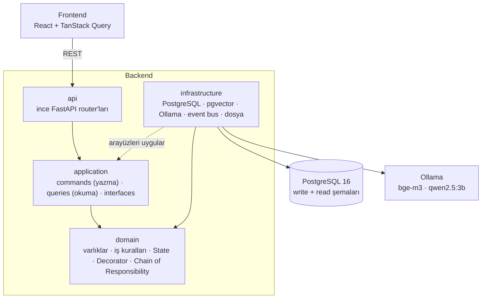
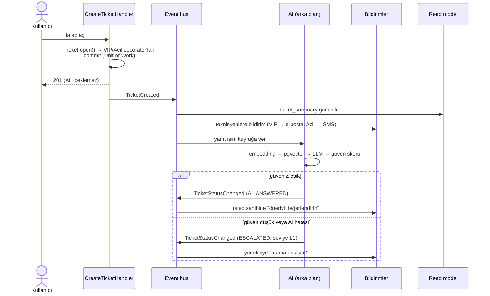

# IT Destek ve Envanter Otomasyonu (RAG destekli)

Bir fakültenin BT departmanı için arıza kaydı (ticket) ve cihaz envanteri sistemi. Kullanıcının sorununu önce
**yerelde çalışan bir yapay zekâ** (RAG: bilgi bankası + LLM) çözmeye çalışır; çözemezse talep teknisyene,
gerekirse kıdemli teknisyene eskale edilir. Cihaz zimmeti, bakım geçmişi, SLA takibi, arıza istatistikleri ve
bildirimler de sistemin parçasıdır.

Yazılım Tasarım Mimarisi dersi projesidir. Öncelik, **mimari kararların ve tasarım desenlerinin doğru
uygulanması ve gerekçelendirilmesidir**; bu kurallar otomatik testlerle denetlenir.

**Teknolojiler:** Python 3.11+ · FastAPI · SQLAlchemy 2 · PostgreSQL 16 + pgvector · Alembic · Ollama ·
React + TypeScript · TanStack Query · Tailwind + shadcn/ui · pytest · GitHub Actions

<!--
Ekran görüntüleri: docs/screenshots/ klasörüne eklenip burada gösterilecek.
Önerilen ekranlar: talep açma + AI yanıtı, teknisyen kuyruğu, yönetici atama kuyruğu, istatistikler, bildirim menüsü.
-->

---

## Özellikler

| Rol | Yapabildikleri |
|---|---|
| **Kullanıcı** | Arıza kaydı açar ve ekran görüntüsü ekler; AI'ın önerisini "çözüldü / çözülmedi" diye değerlendirir; taleplerini ve zimmetli cihazlarını görür |
| **Teknisyen** | Atanan talepleri öncelik ve SLA'ya göre görür; çalışmaya başlar, not ekler, çözer; talebi kıdemli teknisyene eskale eder; cihaza bakım kaydı girer |
| **BT yöneticisi** | Cihaz ekler/günceller, zimmetler/iade alır; talebi seviyesine uygun teknisyene atar; envanter raporunu ve arıza istatistiklerini (SLA uyumu, AI başarısı) görür |
| **AI asistan** | Yeni talebe bilgi bankasından kaynak göstererek yanıt üretir; güveni düşükse talebi doğrudan teknisyene yönlendirir |

Her rol, kendisini ilgilendiren olaylarda (atama, çözüm, eskalasyon, VIP/acil talep) uygulama içi bildirim alır.

---

## Mimari

**Modüler monolit**, sadeleştirilmiş **Clean Architecture** katmanlarıyla. Bağımlılıklar yalnızca içe doğrudur:
`domain` hiçbir katmanı (SQLAlchemy veya FastAPI dahil) bilmez; somut veritabanı, LLM ve dosya kodu
`infrastructure`'dadır. Bu kural `tests/test_architecture.py` ile denetlenir.



### CQRS

Yazma ve okuma ayrı modellerdir:

- **Yazma** (`application/commands`): her iş akışı bir `Command` + `CommandHandler`. Handler'lar repository
  arayüzleri ve **Unit of Work** üzerinden çalışır; kurallar zengin domain nesnelerinin metotlarındadır
  (`device.assign_to(user)`, `ticket.escalate()`).
- **Okuma** (`application/queries`): listeler ve raporlar `read` şemasındaki denormalize tablolardan
  (`ticket_summary`, `device_inventory`) okunur; query handler'lar domain nesnesi değil DTO döner.
- Read model'ler, yazma başarıyla commit edildikten sonra uygulama içi **event bus** ile aynı istekte güncellenir.
  Mesaj kuyruğu ve Event Sourcing bilinçli olarak kullanılmadı: bu ölçekte gereksiz karmaşıklık olurdu.

Ön yüz de aynı ayrımı izler: okumalar `src/api/queries/` altında `useQuery`, yazmalar `src/api/commands/`
altında `useMutation`. Bileşenler API'yi doğrudan çağıramaz (lint kuralı).

### Bir talebin yolculuğu



Talep açma kodu AI'dan, bildirimlerden ve read model'lerden habersizdir; hepsi olayı dinleyen ayrı sınıflardır
(Observer). AI yanıtı CPU'da 45-75 saniye sürebildiği için arka planda üretilir; ön yüz bu sürede yoklama yapar.

---

## Tasarım desenleri

| Desen | Nerede | Neden |
|---|---|---|
| **Facade** | `AiSupportFacade` → `RagAiSupport`, `FakeAiSupport` | RAG'in alt sistemleri (embedding, retriever, prompt, LLM) tek metodun arkasında. Sahte AI'dan gerçeğe geçişte application/domain hiç değişmedi |
| **Strategy** | `EmbeddingProvider`, `LlmProvider` (Ollama); `NotificationSender` (uygulama içi, e-posta/SMS benzetimi) | LLM sağlayıcısı ve bildirim kanalı, kodu değiştirmeden değiştirilebilir |
| **Decorator** | `BasicTicket` ← `VipTicket` ← `UrgentTicket` | VIP ve Acil bağımsız özellikler; SLA (72 → 24 → 4 saat), öncelik puanı ve bildirimler katman katman değişir, alt sınıf patlaması olmaz |
| **Factory** | `TicketComponentFactory`, `Ticket.open`, `UserNotification.deliver` | Veritabanında decorator değil `modifiers` listesi saklanır; nesneyi Factory sarar |
| **State** | `TicketState` ve 7 durum sınıfı | Hangi geçişin hangi durumda mümkün olduğu ve duruma girince kime haber verileceği if/elif yerine durum nesnesinde |
| **Chain of Responsibility** | `SupportTier`: AI (L0) → Teknisyen (L1) → Kıdemli (L2) | Eskale edilen talebi hangi seviyenin üstleneceği ve kime atanabileceği; yeni seviye = yeni halka sınıfı |
| **Observer** | `EventBus`, `EventHandler`; AI zamanlayıcı, projektörler, bildiriciler | Yazma işlemi, ona tepki veren işlerden (AI, read model, bildirim) habersiz |
| **Template Method** | `TicketTransitionHandler`, `Projector`, `TicketNotificationHandler`, `UnitOfWork` | Akış tabanda sabit; alt sınıflar yalnızca değişen adımı doldurur |
| **Repository** | `application/interfaces/repositories.py` → SQLAlchemy ve in-memory | Handler'lar veritabanını bilmez; testler veritabanısız çalışır |
| **Unit of Work** | `UnitOfWork` → `SqlAlchemyUnitOfWork` | Bir command'ın tüm değişiklikleri tek transaction'da; olaylar yalnızca başarılı commit'ten sonra yayınlanır |
| **Data Mapper** | `infrastructure/db/mappers.py` | Domain sınıfları ile SQLAlchemy modelleri ayrı; çeviri varlık başına bir sınıfta |

Her desen sınıfının docstring'i desenin adını ve rolünü yazar (`tests/test_pattern_docstrings.py` denetler).

### Nesne yönelimli tasarım kuralları

- **Kapsülleme:** domain varlıklarının alanları korumalıdır, setter yoktur; durum yalnızca anlamlı metotlarla
  değişir (`device.status = ...` yerine `device.assign_to(user)`).
- **Soyutlama ve çok biçimlilik:** tüm arayüzler `abc.ABC`; tür/durum kontrolü için if/elif yerine çok biçimli
  metotlar (`sla_hours()`, `escalate()`, `entry_notifications()`).
- **Kural ihlalleri** `DomainError` hiyerarşisinden domain'e özgü hatalardır ve API'de tek yerde HTTP koduna çevrilir.
- **Denetim:** `tests/test_oop_structure.py` handler kalıtımını, command/query adlarını ve değiştirilemezliğini,
  varlıkların kapsüllenmesini ve modül seviyesinde fonksiyon olmamasını; `ruff` her metotta tip ipucunu denetler.

---

## Başlıca iş kuralları

- Bir cihazın aynı anda tek aktif zimmeti ve tek açık bakım kaydı olabilir; bakım açılınca cihaz `IN_REPAIR` olur,
  kapanınca önceki durumuna döner.
- AI güven skoru eşiğin (varsayılan 0.6) altındaysa yanıt kullanıcıya gösterilmez, talep doğrudan eskale edilir.
- Talep yalnızca seviyesine yetecek teknisyene atanabilir (L2 talep → kıdemli teknisyen).
- Ekran görüntüsünün türü dosya adına değil içeriğin ilk baytlarına (magic bytes) bakılarak belirlenir.
- Yetki basit rol kontrolüyle backend'de uygulanır (`X-User-Id` başlığı); arayüzdeki rol koruması yalnızca kullanıcı
  deneyimi içindir.

---

## Kurulum (Windows / PowerShell)

Gerekenler: Docker Desktop, Python 3.11+, Node.js 22. Gerçek AI için ayrıca [Ollama](https://ollama.com).

```powershell
# 1. Ayarlar ve veritabanı (PostgreSQL 16 + pgvector)
Copy-Item .env.example .env
docker compose up -d

# 2. Backend
python -m venv .venv
.venv\Scripts\Activate.ps1
pip install -r requirements.txt
alembic upgrade head
python -m app.infrastructure.db.seed     # örnek kullanıcılar ve cihazlar
uvicorn app.main:app --reload            # http://127.0.0.1:8000/docs

# 3. Frontend (ayrı terminalde)
cd frontend
npm install
npm run dev                              # http://localhost:5173
```

Giriş ekranı yoktur (kapsam dışı): üst menüdeki kutudan kullanıcı seçilir. Seed verisinde kullanıcı, VIP kullanıcı
(dekan), teknisyen, kıdemli teknisyen ve yönetici bulunur.

### Gerçek AI (isteğe bağlı)

Varsayılan `AI_PROVIDER=fake` anahtar kelimeyle çalışan sahte bir AI'dır. Gerçek RAG için:

```powershell
ollama pull bge-m3          # embedding (1024 boyut)
ollama pull qwen2.5:3b      # yanıt modeli
python -m app.infrastructure.ai.indexing     # data/knowledge/*.md → pgvector
# .env: AI_PROVIDER=rag
```

Güven skorunun kalibrasyonu: `python -m app.infrastructure.ai.calibrate [--with-llm]`.

---

## Testler ve kalite

```powershell
ruff check app tests migrations
pytest --cov
```

- ~590 test; veritabanı testleri gerçek PostgreSQL'de çalışır ve her test sonunda geri alınır. Veritabanı yoksa
  atlanır (CI'da atlanmaz, başarısız olur).
- Test kapsamı %93 (dal kapsamı dahil); %90'ın altına düşerse CI başarısız olur.
- **GitHub Actions** her push'ta: ruff → migration'ları boş veritabanına uygula → modelle migration'lar uyumlu mu
  (`alembic check`) → testler ve kapsam (Python 3.11 ve 3.14); frontend'de lint ve tip denetimli derleme.

---

## Proje yapısı

```
app/
  api/              ince FastAPI router'ları, hata → HTTP kodu eşlemesi
  application/
    commands/       CQRS yazma tarafı (command + handler)
    queries/        CQRS okuma tarafı (DTO döner)
    interfaces/     repository, Unit of Work, AI Facade, event bus, bildirim göndericisi arayüzleri
  domain/           varlıklar, iş kuralları, State, Decorator, Chain of Responsibility, bildirim tarifleri
  infrastructure/
    db/             SQLAlchemy modelleri, mapper'lar, repository'ler, read model projektörleri
    ai/             RAG: parçalama, indeksleme, pgvector retriever, prompt, Ollama, Facade
    events/         uygulama içi event bus, arka plan iş kuyruğu
    notifications/  bildirim kanalları (Strategy)
    storage/        ekran görüntüsü depolama
migrations/         Alembic (write ve read şemaları)
frontend/src/       api (queries / commands), sayfalar (kullanıcı, teknisyen, yönetici), bileşenler
data/knowledge/     RAG bilgi bankası (Markdown)
tests/              birim, entegrasyon, API ve mimari kural testleri
```
